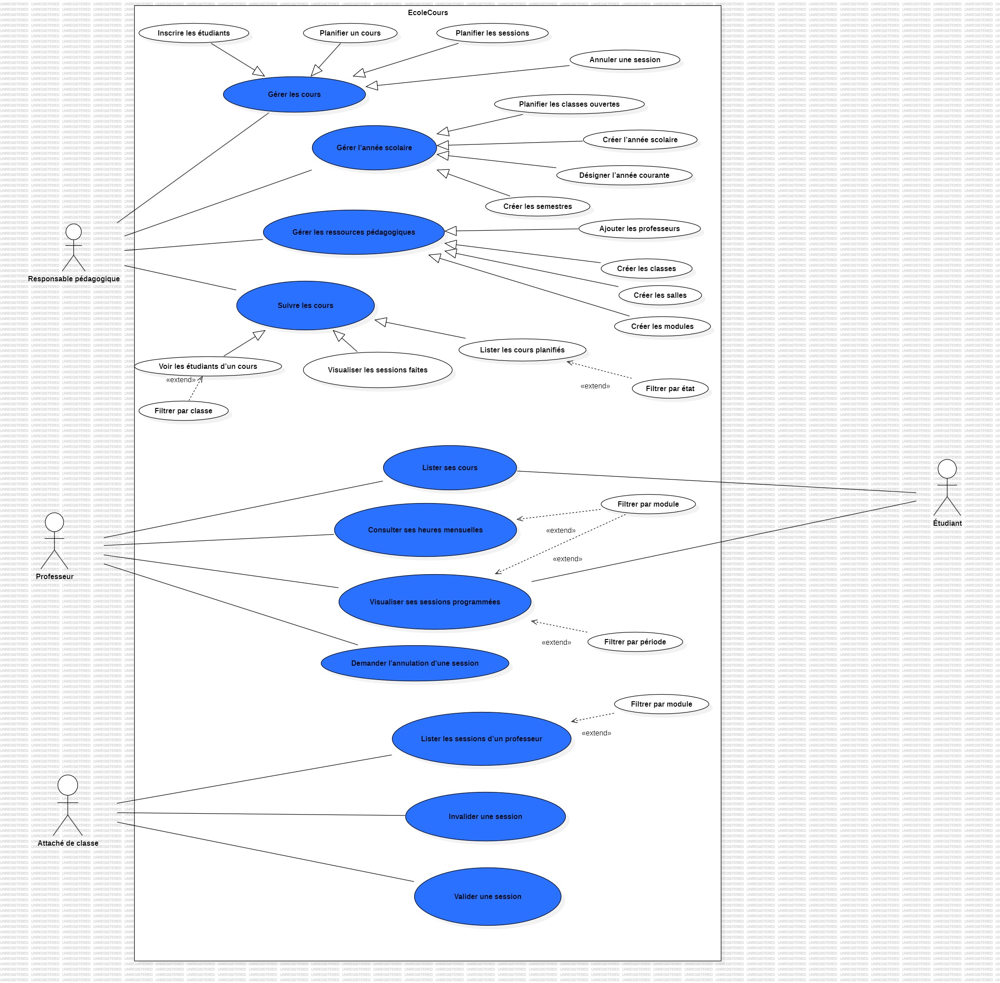
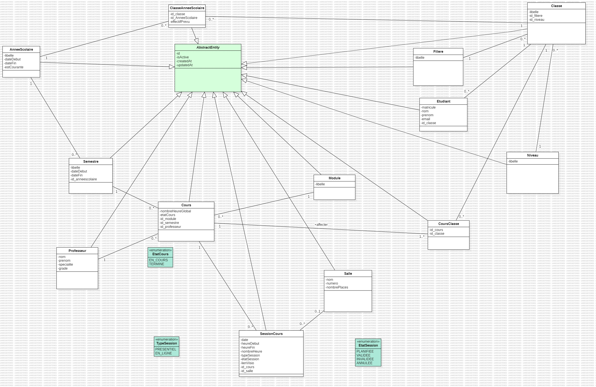

# Gestion des cours - Ecole 221

API REST de planification des cours (Spring Boot).

## Stack

| Élément | Version |
|---|---|
| Java | 17 |
| Spring Boot | 4.1.2  à la place de 3.5.x) |
| Base de données | MySQL 8 |
| Build | Maven, via le wrapper `./mvnw` |
| Port de l'API | 8080 |

## Organisation du dépôt

```
gestion_cours/
├── README.md
├── docs/            diagrammes et tableau des relations
├── githooks/        hook pre-commit versionné
└── planification/   projet Spring Boot
```

## Prérequis

- **Java 17** (vérifier avec `java -version`)
- **MySQL 8**, démarré
- Maven

## 1. Créer la base de données

Avec un compte administrateur MySQL (par exemple `root` dans MySQL Workbench), exécuter en
remplaçant `***` par un mot de passe de votre choix :

```sql
CREATE DATABASE planification
  CHARACTER SET utf8mb4
  COLLATE utf8mb4_unicode_ci;

CREATE USER 'planif_modou'@'localhost' IDENTIFIED BY '***';
GRANT ALL PRIVILEGES ON planification.* TO 'planif_modou'@'localhost';
FLUSH PRIVILEGES;
```

L'application se connecte avec cet utilisateur dédié, qui n'a des droits que sur la base
`planification`, et non avec `root`.

## 2. Configurer l'accès à la base

Le mot de passe MySQL n'est jamais écrit dans un fichier versionné.
`planification/src/main/resources/application.properties` ne contient que des références :

```properties
spring.config.import=optional:classpath:application-local.properties
spring.datasource.url=jdbc:mysql://localhost:3306/${DB_NAME}
spring.datasource.username=${DB_USER}
spring.datasource.password=${DB_PASSWORD}
```

Les valeurs sont dans un fichier local, **ignoré par git** (voir `.gitignore`). Pour le créer,
copier le modèle fourni puis le remplir :

```powershell
cd planification/src/main/resources
copy application-local.properties.example application-local.properties
```


**Comment ça marche.** La ligne `spring.config.import=optional:classpath:application-local.properties`
demande à Spring de lire aussi ce fichier au démarrage. Spring remplace alors chaque `${DB_NAME}`,
`${DB_USER}` et `${DB_PASSWORD}` par la valeur trouvée. Le préfixe `optional:` évite une erreur si
le fichier est absent.

**Pourquoi ce choix.** Des variables d'environnement auraient aussi fonctionné, mais il aurait fallu
les redéfinir dans chaque nouveau terminal. Le fichier local se configure une seule fois. Le risque,
le commiter par erreur, est couvert par le `.gitignore` et par la règle 1 du hook.

## 3. Lancer l'application

```powershell
cd planification
./mvnw spring-boot:run
```

L'application est prête quand la console affiche :

```
HikariPool-1 - Start completed.
Tomcat started on port 8080 (http)
Started PlanificationApplication in ... seconds
```

`HikariPool-1 - Start completed` confirme la connexion à MySQL. Arrêter avec `Ctrl+C`.

### Jeu de données de départ

Au premier démarrage, la classe `config/DataInitializer` (un `CommandLineRunner`) insère
un jeu de test : une année scolaire courante (2026-2027), un semestre, 3 filières, 5 niveaux,
5 classes, 2 professeurs, 2 salles, 3 modules et 3 étudiants.

**Rejouable** : si une année scolaire existe déjà en base, rien n'est inséré. La console
affiche alors `Jeu de donnees deja present : aucune insertion.`

**Pourquoi un `CommandLineRunner` plutôt que `data.sql`** : les insertions passent par les
repositories, donc `@PrePersist` remplit `createdAt` et `isActive` automatiquement, et les
relations utilisent des objets vérifiés par le compilateur au lieu d'identifiants écrits en dur.

## Utiliser l'API

Toutes les réponses ont la même forme. Quand tout se passe bien, on reçoit le code HTTP et le
résultat dans `results` :

```json
{ "status": 200, "results": [ ... ] }
```

Quand quelque chose ne va pas, on reçoit le code d'erreur et un message en français qui explique
le problème :

```json
{ "status": 404, "message": "Module introuvable : 999" }
```

### Les routes disponibles

| Méthode | Route | À quoi elle sert |
|---|---|---|
| GET | `/api/v1/modules` | lister les modules actifs |
| GET | `/api/v1/modules/{id}` | consulter un module précis |
| POST | `/api/v1/cours` | planifier un nouveau cours |
| POST | `/api/v1/cours/{coursId}/sessions` | planifier une séance d'un cours |
| GET | `/api/v1/professeurs/{professeurId}/sessions` | voir les séances et les heures d'un professeur sur un mois |

### Planifier un cours

On envoie le quota d'heures, le module, le professeur, le semestre et les classes concernées :

```http
POST http://localhost:8080/api/v1/cours
Content-Type: application/json

{
  "nombreHeureGlobal": 60,
  "moduleId": 2,
  "professeurId": 1,
  "semestreId": 1,
  "classeIds": [1, 2]
}
```

Si tout est correct, l'API répond `201` avec le cours créé. Il démarre à l'état `EN_COURS`, et
chaque classe de la liste lui est rattachée.

Avant de créer quoi que ce soit, l'API vérifie la demande et la refuse dans les cas suivants :

| Situation | Réponse |
|---|---|
| le module, le professeur ou le semestre n'existe pas | `404`, par exemple « Module introuvable : 3 » |
| une des classes n'existe pas | `404`, par exemple « Classe introuvable : 7 » |
| la liste des classes est vide ou absente | `400` « Un cours doit s'adresser a au moins une classe » |
| le nombre d'heures manque ou n'est pas positif | `400`, avec le détail du champ en cause |
| le semestre n'appartient pas à l'année scolaire courante | `400` « Le semestre 2 n'appartient pas a l'annee scolaire courante » |

La création est faite d'un seul bloc : si une classe est introuvable au milieu de la liste, rien
n'est enregistré, pas même le cours.

### Planifier une session

Une session est une séance concrète d'un cours : une date, une heure de début et une heure de
fin. Elle se déroule soit en présentiel dans une salle, soit en ligne avec un lien de visio.

```http
POST http://localhost:8080/api/v1/cours/1/sessions
Content-Type: application/json

{ "date": "2026-11-12", "heureDebut": "09:00", "heureFin": "12:00", "typeSession": "PRESENTIEL", "salleId": 1 }
```

Pour une session en ligne, on remplace `salleId` par `lienVisio`. On n'envoie jamais le nombre
d'heures : l'API le calcule à partir des deux horaires (ici 3 heures). La session démarre à
l'état `PLANIFIEE`.

Avant d'enregistrer la séance, l'API vérifie qu'elle est possible :

| Situation | Réponse |
|---|---|
| le cours n'existe pas | `404` « Cours introuvable : 12 » |
| l'heure de fin n'est pas après l'heure de début | `400` |
| une session en présentiel sans salle | `400` |
| une session en ligne avec une salle, ou sans lien de visio | `400` |
| la date tombe en dehors du semestre du cours | `400` « La date du 01/03/2027 est hors du Semestre 1 » |
| le quota d'heures du cours serait dépassé | `409` « Le quota de 60 heures serait dépassé : 58 heures déjà planifiées, 3 demandées » |
| la salle est déjà prise sur ce créneau | `409` « La salle A101 est déjà occupée le 12/11/2026 de 10:00 à 13:00 » |
| le professeur a déjà une séance sur ce créneau | `409` « Le professeur ... a déjà une session le 12/11/2026 de 10:00 à 13:00 » |

Deux créneaux se chevauchent dès qu'ils ont au moins une minute en commun. Une séance qui
commence à 13:00 peut donc suivre une séance qui se termine à 13:00. La salle et le professeur
sont vérifiés séparément, directement en base, et les séances annulées ou désactivées ne
comptent ni pour le quota ni pour les conflits.

### Les heures d'un professeur sur un mois

Cette route sert à l'attaché de classe pour suivre le travail d'un professeur :

```http
GET http://localhost:8080/api/v1/professeurs/1/sessions?mois=2026-11&moduleId=2
```

Les deux paramètres sont facultatifs. Sans `mois`, l'API prend le mois en cours. Sans
`moduleId`, elle renvoie les séances de tous les modules du professeur.

```json
{
  "status": 200,
  "results": {
    "professeur": { "id": 1, "nom": "marega", "prenom": "Aboubacar" },
    "mois": "2026-11",
    "totalHeuresPlanifiees": 5,
    "totalHeuresEffectuees": 3,
    "sessions": [ ... ]
  }
}
```

Les deux totaux ne mesurent pas la même chose. Les heures **effectuées** ne comptent que les
séances validées par l'attaché, c'est-à-dire celles dont on sait qu'elles ont vraiment eu lieu.
Les heures **planifiées** comptent les séances prévues et les séances validées, mais jamais les
séances annulées.

Le tri par professeur, par mois et par module est fait directement par la base de données, avec
une requête JPQL : on ne charge que les séances utiles, même si la table en contient des milliers.

Si le professeur n'existe pas, l'API répond `404`. S'il n'a aucune séance sur la période, elle
répond `200` avec une liste vide et des totaux à zéro.

### Tester l'API

Le fichier `planification/api-tests.http` contient toutes ces requêtes, cas d'erreur compris.
Dans IntelliJ, on l'ouvre et on clique sur la flèche à côté de chaque requête (ou sur la double
flèche en haut pour tout lancer d'un coup). L'application doit être démarrée.

Les tests des sessions commencent par créer deux cours, dont IntelliJ retient les identifiants
pour les requêtes suivantes. Les séances créées restent en base : pour relancer toute la série,
il faut d'abord vider la table des sessions (données de test uniquement) :

```sql
SET SQL_SAFE_UPDATES = 0;
DELETE FROM session_cours;
SET SQL_SAFE_UPDATES = 1;
```

Pour voir la différence entre heures planifiées et effectuées, il faut au moins une séance
validée. La validation par l'attaché n'existe pas encore dans l'API : on peut la simuler dans
MySQL avec `UPDATE session_cours SET etat_session = 'VALIDEE' WHERE id = ...;`

Pour le test du semestre hors de l'année courante, il faut un semestre rattaché à une année qui
n'est pas courante. Le jeu de données n'en contient pas : on peut l'ajouter dans MySQL avec

```sql
INSERT INTO annee_scolaire (libelle, date_debut, date_fin, est_courante, is_active, created_at)
VALUES ('2025-2026', '2025-09-01', '2026-07-31', false, true, NOW());

INSERT INTO semestre (libelle, date_debut, date_fin, annee_scolaire_id, is_active, created_at)
VALUES ('Semestre 1', '2025-09-01', '2026-01-31', LAST_INSERT_ID(), true, NOW());
```

### Pourquoi certaines relations n'apparaissent pas dans le JSON

Pour l'instant, l'API renvoie directement les entités. Or beaucoup de relations existent dans
les deux sens : un cours connaît son semestre, et le semestre connaît la liste de ses cours.
En transformant un cours en JSON, on passerait donc du cours au semestre, du semestre à ses
cours, de ces cours à leur semestre, et ainsi de suite sans fin. C'est ce qui s'est produit au
premier essai : la réponse faisait plus de 80 ko et s'arrêtait en plein milieu.

Pour casser ces boucles, on a masqué le côté « liste » de chaque relation avec `@JsonIgnore`.
Un cours affiche donc toujours son module, son semestre et son professeur, mais un semestre
n'affiche plus la liste de ses cours.

| Entité | Champs masqués |
|---|---|
| `AnneeScolaire` | `semestres`, `classesAnneeScolaire` |
| `Semestre` | `cours` |
| `Filiere` | `classes` |
| `Niveau` | `classes` |
| `Classe` | `etudiants`, `classesAnneeScolaire`, `coursClasses` |
| `Module` | `cours` |
| `Professeur` | `cours` |
| `Cours` | `sessionCours`, `coursClasses` |
| `Salle` | `sessionCours` |

Il y avait aussi un champ technique, `hibernateLazyInitializer`, qui apparaissait dans certaines
réponses. Il vient d'Hibernate, qui ne charge certaines données qu'au moment où on en a besoin.
Il est masqué une fois pour toutes avec `@JsonIgnoreProperties` sur `AbstractEntity`.

Ces deux annotations sont une solution provisoire. Au lot 2, l'API renverra des objets de réponse
dédiés (les DTO) au lieu des entités, et le problème disparaîtra à la source.

## 4. Activer le hook pre-commit

À faire **une fois par clone**, depuis la racine du dépôt :

```bash
git config core.hooksPath githooks
```

Vérification : `git config core.hooksPath` doit répondre `githooks`.

Le hook `githooks/pre-commit` refuse un commit dont les lignes ajoutées contiennent :

| Règle | Ce qui est refusé | À la place |
|---|---|---|
| 1 | un secret en clair (`password`, `secret`, `token`, `apikey`) dans un `.properties`, `.yml`, `.yaml` ou `.java` | une référence `${VARIABLE}` |
| 2 | `@Autowired` | `@RequiredArgsConstructor` et des champs `private final` |
| 3 | `System.out.print` | `@Slf4j` et `log.info(...)` |
| 4 | `throw new RuntimeException` | une exception de `exceptions/` qui porte le bon code HTTP |
| 5 | une icône ou un émoji, dans n'importe quel fichier | une phrase |

Ne pas contourner le hook avec `git commit --no-verify`.

## Diagramme de cas d'utilisation



## Diagramme de classes



Source StarUML des deux diagrammes : [docs/diagrammedeclasse.mdj](docs/diagrammedeclasse.mdj)
