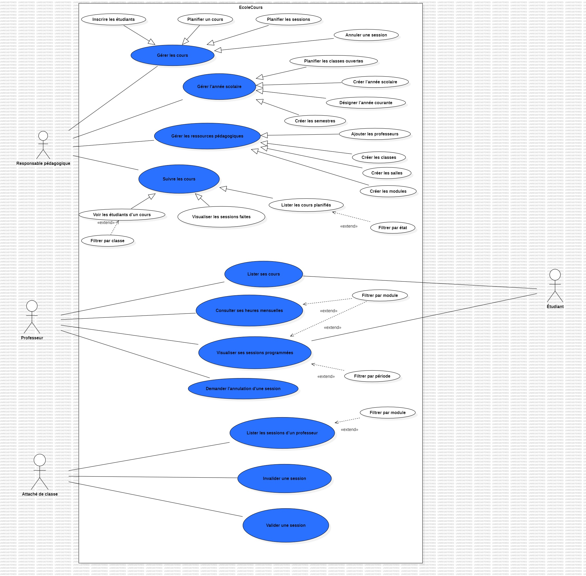
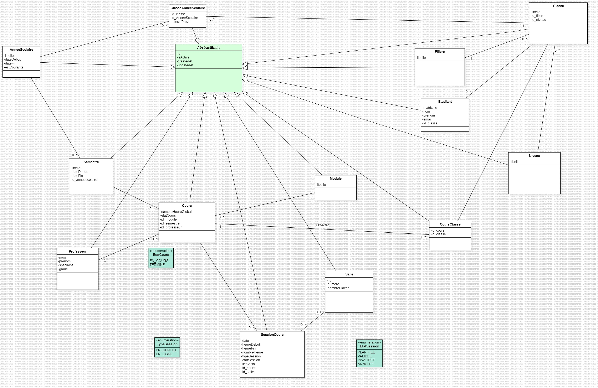

# Gestion des cours - Ecole 221

API REST de planification des cours (Spring Boot).

## Stack

| Élément | Version |
|---|---|
| Java | 17 |
| Spring Boot | 4.1.2  à la place de 3.5.x) |
| Base de données | MySQL 8 |
| Build | Maven, via le wrapper `./mvnw` |
| Port de l'API | 8080 |

## Organisation du dépôt

```
gestion_cours/
├── README.md
├── docs/            diagrammes et tableau des relations
├── githooks/        hook pre-commit versionné
└── planification/   projet Spring Boot
```

## Prérequis

- **Java 17** (vérifier avec `java -version`)
- **MySQL 8**, démarré
- Maven

## 1. Créer la base de données

Avec un compte administrateur MySQL (par exemple `root` dans MySQL Workbench), exécuter en
remplaçant `***` par un mot de passe de votre choix :

```sql
CREATE DATABASE planification
  CHARACTER SET utf8mb4
  COLLATE utf8mb4_unicode_ci;

CREATE USER 'planif_modou'@'localhost' IDENTIFIED BY '***';
GRANT ALL PRIVILEGES ON planification.* TO 'planif_modou'@'localhost';
FLUSH PRIVILEGES;
```

L'application se connecte avec cet utilisateur dédié, qui n'a des droits que sur la base
`planification`, et non avec `root`.

## 2. Configurer l'accès à la base

Le mot de passe MySQL n'est jamais écrit dans un fichier versionné.
`planification/src/main/resources/application.properties` ne contient que des références :

```properties
spring.config.import=optional:classpath:application-local.properties
spring.datasource.url=jdbc:mysql://localhost:3306/${DB_NAME}
spring.datasource.username=${DB_USER}
spring.datasource.password=${DB_PASSWORD}
```

Les valeurs sont dans un fichier local, **ignoré par git** (voir `.gitignore`). Pour le créer,
copier le modèle fourni puis le remplir :

```powershell
cd planification/src/main/resources
copy application-local.properties.example application-local.properties
```

(`cp` au lieu de `copy` sous Linux ou macOS.)

```properties
DB_NAME=planification
DB_USER=planif_modou
DB_PASSWORD=le_mot_de_passe_choisi_a_l_etape_1
```

**Comment ça marche.** La ligne `spring.config.import=optional:classpath:application-local.properties`
demande à Spring de lire aussi ce fichier au démarrage. Spring remplace alors chaque `${DB_NAME}`,
`${DB_USER}` et `${DB_PASSWORD}` par la valeur trouvée. Le préfixe `optional:` évite une erreur si
le fichier est absent.

**Pourquoi ce choix.** Des variables d'environnement auraient aussi fonctionné, mais il aurait fallu
les redéfinir dans chaque nouveau terminal. Le fichier local se configure une seule fois. Le risque,
le commiter par erreur, est couvert par le `.gitignore` et par la règle 1 du hook.

## 3. Lancer l'application

```powershell
cd planification
./mvnw spring-boot:run
```

L'application est prête quand la console affiche :

```
HikariPool-1 - Start completed.
Tomcat started on port 8080 (http)
Started PlanificationApplication in ... seconds
```

`HikariPool-1 - Start completed` confirme la connexion à MySQL. Arrêter avec `Ctrl+C`.

## 4. Activer le hook pre-commit

À faire **une fois par clone**, depuis la racine du dépôt :

```bash
git config core.hooksPath githooks
```

Vérification : `git config core.hooksPath` doit répondre `githooks`.

Le hook `githooks/pre-commit` refuse un commit dont les lignes ajoutées contiennent :

| Règle | Ce qui est refusé | À la place |
|---|---|---|
| 1 | un secret en clair (`password`, `secret`, `token`, `apikey`) dans un `.properties`, `.yml`, `.yaml` ou `.java` | une référence `${VARIABLE}` |
| 2 | `@Autowired` | `@RequiredArgsConstructor` et des champs `private final` |
| 3 | `System.out.print` | `@Slf4j` et `log.info(...)` |
| 4 | `throw new RuntimeException` | une exception de `exceptions/` qui porte le bon code HTTP |
| 5 | une icône ou un émoji, dans n'importe quel fichier | une phrase |

Ne pas contourner le hook avec `git commit --no-verify`.

## Diagramme de cas d'utilisation



## Diagramme de classes



Source StarUML des deux diagrammes : [docs/diagrammedeclasse.mdj](docs/diagrammedeclasse.mdj)
